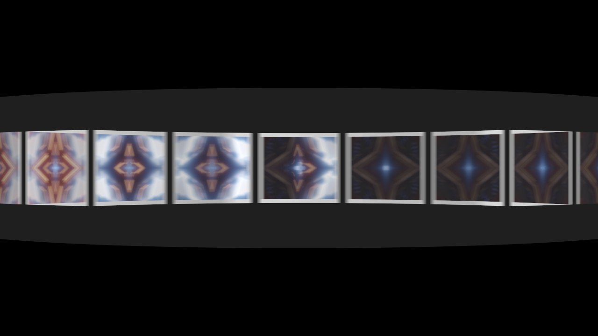

# zoetrope

> **AI-assisted project.** This codebase was created with [Claude](https://claude.com/claude-code)
> (Anthropic), directed and reviewed by a human author. Its behaviour is measured rather
> than asserted: an offline harness drives the plugin's own class in a headless GL context
> and checks each claim out of the picture. A disc locked to the beat stands still to a
> ten-thousandth of a pixel over a hundred flashes; a crawl advances by the wrapped turn per
> flash to 3e-8 rad; a smear is ω τ R long to a few hundredths of a percent; a flash keeps its
> light whatever its length; every card shows the frame of the clip it was printed with; a
> hand-spun disc follows an independent RK4 solution of its bearing to a ten-millionth of a
> radian and stops when the closed form says; and in the drum the figures stand where the
> geometry puts them, squeezed by (d + a) / 2d. 17 negative controls and 13 one-character
> mutants prove the checks can fail. It's **never been loaded into Resolume**, on any
> machine. The full rundown is under [Status](#status).

The clip's frames printed on the cards of a spinning disc, seen only in the light of a
strobe that fires on the music. An FFGL effect for [Resolume](https://resolume.com) Arena
and Avenue.


<sub>One frame, rendered by `zttest`, the offline harness, not captured from Resolume.
Resolume's bundled `IntoTheGlow_02`, a flash on every eighth of a beat at 120 BPM with
the disc locked to it, 20% room light and a 3 ms flash: the cards stand still in the
flash, smeared a little by its length, with the room light's blur of the disc's turn over
the same exposure behind them.</sub>

## The one idea

**Nothing here is animated. The clip is printed onto a disc of cards, the disc turns, and
you only see it when the strobe fires.**

It's the oldest trick in moving pictures, run backwards. A Victorian zoetrope takes a strip
of drawings and turns it into motion; this takes the motion and turns it back into a strip,
then shows you the strip the way a zoetrope would:

- **the print head** prints the clip onto each card as the card's centre passes it, and
  the print stays until the card comes round again;
- **the disc** turns at whatever speed its drive gives it: a motor locked to the host's
  tempo, a motor at so many RPM, or a hand that pushes it on the beat and a bearing that
  slows it down between pushes;
- **the strobe** fires on the beat (or its subdivisions, or the bar, or onsets in the
  audio, or a free-running rate, or when you press Fire), each flash a short rectangle of
  light with the same energy however long it is;
- **the camera** sees whatever lands inside its exposure: the flashes, and a little room
  light, integrated over the shutter.

## What falls out

None of this is drawn. Each is the disc and the light doing what they do.

- **The figures stand still and play the clip.** Turn exactly one card per flash and every
  flash finds a card at every station. Each station then shows the clip, a flash's worth
  later than the one before it round the ring: a delay line you can see, starting at the
  print head.
- **The wagon wheel.** A disc a touch slow (Slip 0.98) crawls backwards; a touch fast
  crawls forwards; two cards per flash looks locked again, just skipping. The apparent
  turn per flash is the real turn modulo a station, wrapped to half a station either way.
- **Jumps.** Fire on onsets and the flashes land irregularly, so the figures jump about by
  however far the disc happened to turn.
- **Smear.** A long flash catches the disc moving: a card smears into an arc ω τ R long,
  and the light per flash stays the same, so it smears without getting brighter.
- **The blur between flashes.** The room light shows the disc for what it is between
  flashes: a spinning blur, as long as the turn over the exposure.
- **The camera's own aliasing.** A strobe faster than the frame rate beats against the
  shutter, so some frames catch two flashes and some catch one, or none. Anyone who's
  pointed a camera at an LED wall will recognise it.
- **Printing.** You can watch it happen: a card changes as it passes the head. A fresh disc
  (or a change of Stations, which is a new disc) starts blank, white card stock, and fills
  in as it turns.

## The drum

**View Drum** is the original zoetrope: the same cards on the inside of a drum, seen through
slits in its near wall, under steady light. The slits are the shutter. As each slit passes
your eye you see a sliver of the card on the far side, and because the near wall and the far
wall move in opposite directions the figures come out narrower than they're printed, by
(d + a) / 2d at the middle of the view for an eye d from the axis of a drum of radius a.
Here the eye is three radii out, so two thirds.



<sub>The drum on `IntoTheGlow_02`, rendered by `zttest`: Sync on every eighth of a beat at
120 BPM and 120 ms of Persistence. Without Persistence the camera sees what a 60 fps
camera really sees of a zoetrope, which is the slits sweeping across the figures a few
at a time. With the eye's afterimage it reads as it does in the room.</sub>

The lamp is the Strobe level, steady, plus the room light; the camera is opened up by the
slits' duty cycle (a sixteenth of a station each), much as your eye adapts to one.

## Controls

| Group | |
| --- | --- |
| **Strobe** | Trigger (Beat, Half Beat, Quarter Beat, Eighth Beat, Bar, Onset, Rate, Fire Only), Rate (0.25–200 Hz, free running), Fire (a flash now, in every mode; with Hand drive, a push), Audio (Resolume's audio input), Threshold (how hard an onset must hit), Flash (10 µs to 20 ms), Strobe (the light one flash gives, 0–2). |
| **Disc** | Stations (4–48 cards), Drive (Motor, Hand), Sync (the motor turns Slip cards per flash at the host's tempo), Slip (0–2), RPM (0–600, with Sync off), Push (what one push adds, 1–120 RPM), Friction (the bearing), Print At (the print head's angle), Radius, Card Size (up to the widest that can't touch a neighbour). |
| **Camera** | Shutter (0–360°), Room Light, Persistence (the eye's afterimage, 0–200 ms; off is the honest camera), Background (Black, or the clip behind the disc), Mix. |
| **View** | View (Disc, Drum). |

The defaults are twelve cards locked to the beat: a millisecond's flash on every beat at
whatever tempo Resolume is playing, the disc turning one card per flash, a 360° shutter (so
no flash falls between two exposures) and 8% room light. Each figure plays the clip a beat
later than the one before it round the ring, which at 120 BPM is half a second a card.

## Status

**Unreleased, 15 October 2026: built, measured offline, never run in a host.**

### Measured offline, on macOS

`tools/verify.sh` passes on this machine (Apple Silicon, macOS 26) against a fresh
universal Release build. It runs every picture check at **two rasters**, 1280×720 and
320×180, and again on **Apple's software renderer** at 320×180. What it establishes:

| check | result |
| --- | --- |
| `--drift` | 32 advances per flash over eight Slips from 0.6 to 2, each read off the picture by the ring's N-fold phase and corrected by the instrument's own error at its two angles (read off a held twin): within **3e-8 rad** of the wrapped ω T (tolerance 7e-6). Uncorrected, within 9e-5 rad, which is the instrument's own worst over 140 held angles (0.02 px at the ring) |
| `--lock` | Slip 1 with Sync, a flash every eighth of a beat: **100 flashes**, the ring's phase within **4e-7 rad** of the first's, 0.0001 px at the ring |
| `--smear` | a radial edge smeared by one flash: **40.0020 px** against ω τ R = 40.0000 (64 taps), **13.3739** against 13.3700 (16 taps), each within its staircase's tolerance (0.43 and 0.14 px), and centred on the disc's angle at the flash's middle to 0.0006 px |
| `--energy` | one flash summed over the frames that caught it is **1.000000** of Strobe × the print at 10 µs, 1 ms, 12 ms and 20 ms (that one split over two frames); the room light's blur of a turning disc keeps the ring's total within the still ring's spread |
| `--delay` | **88 of 88** cards over 11 flashes, read off the picture as frame numbers, show the frame printed (φ − h) / ω before |
| `--bearing` | the hand-spun disc's closed form against RK4 over six pushes and a coast: **3e-11 rad**; each push adds Push to 5e-9 rad/s; the disc, RK4 and ln(1 + kω/c)/k all stop it at 6.419108 s |
| `--hand` | the same out of the picture: within **1.2e-7 rad** of RK4 for 480 frames (tolerance 6e-6), and not a bit of movement in the 118 frames after the closed form's stop |
| `--beat` | every flash on its beat, half, quarter or eighth beat or bar, on the host's clock and the plugin's own, to **2e-15 s**; Rate's m-th flash at m / Rate |
| `--alias` | what each frame's shutter catches, against the closed form of its window: Rate 157 Hz through 200° (127 frames catch one flash, 108 catch two), 61.7 Hz through 90°, beats at 117 BPM through 180°: worst **2e-7** of a flash |
| `--audio` | six kicks, six flashes, each caught on its kick's own frame; none from a cold start that's already loud |
| `--resize` | after the host's raster changes, **8 of 8** cards read the same frame number |
| `--drum` | the figures' centre lines within **0.01 px** of the harness's own ray geometry (0.02 at 320×180); squeezed to 0.66955 of the still drum's width across a station either side, the geometry's 0.66956; at the middle the geometry's slope is exactly (d + a) / 2d |
| `--afterimage` | Persistence 100 ms: each frame keeps **0.8465** of the last, exp(−T/τ), to the half-float afterimage's 2e-3, and the eye sees the whole flash, 0.998 of it on this GPU (which truncates each half-float store) and 1.00000 on the software renderer |
| `--alpha`, `--state` | the disc and a black background are opaque and the clip behind keeps its alpha; the host's GL state comes back |
| `--negative` | **17** deliberately wrong models, **17** caught |
| mutation | **13** one-character mutants of the shipped GLSL and C++, **13** caught |
| `tools/sweep.py` | all **22** controls it can move measurably change the picture; the 23rd, Audio, is the input Threshold is swept through |
| shaders | all 5 compile through `glslc`, not merely through Apple's driver |
| the bundle | universal (`x86_64 arm64`), exports `plugMain`, ad-hoc signs; `oxbow` reports `SW Zoetrope` / `ZT01` / `effect` and renders 120 frames through `plugMain` |

Render cost, GPU time by `GL_TIME_ELAPSED`, median of 120 frames after a warm-up, on a
GPU shared with other work, so the small numbers wobble: at the defaults, **0.08 ms** at
720p, **0.12 ms** at 1080p and **0.60 ms** at 4K (0.28, 0.33 and 1.05 ms of wall time).
The worst case I could think of, a 150 Hz strobe of 20 ms flashes on a disc at 600 RPM in
room light, with Persistence: **1.9**, **3.6** and **8.9 ms**, which at 4K is over half a
60 fps frame. The drum at 600 RPM with Persistence: **1.2**, **1.2** and **3.8 ms**. macOS
figures only.

### Not established

It's **never been loaded into Resolume**, on macOS or Windows. Everything above was
compiled, rendered and measured offline against the plugin's own class in a headless CGL
context, plus an `oxbow` load. I haven't seen how the 23 controls read in Arena's
inspector, how Trigger follows Arena's transport, or what Resolume's FFT does to the onset
detector. The Windows build has never been compiled.

A card is printed with the frame of the clip the host hands over on the frame its centre
passes the head, so a print is up to a frame later than the moment it stands for. The
drum's hand-spun disc is inverted on a 16-piece table across the exposure, which is close
but not the closed form. AGENTS.md lists every approximation.

No user guide, no OpenFX port, no presets. The browser demo is below.

## Build

macOS (universal: Apple Silicon and Intel):

```bash
git clone --recurse-submodules https://github.com/stoatworks-labs/zoetrope
```

```bash
cmake -B build -DCMAKE_BUILD_TYPE=Release
```

```bash
cmake --build build
```

```bash
cmake --install build
```

The last one copies `Zoetrope.bundle` into `~/Documents/Resolume Arena/Extra Effects`.
Restart Arena and it's under Effects as **SW Zoetrope**.

Windows needs Visual Studio 2022 and vcpkg (for GLEW); see `.github/workflows/ci.yml`.

## Building and testing

```bash
tools/verify.sh
```

That's the whole lot: a fresh universal build, every check at two rasters and on the
software renderer, the negative controls, the mutants, the sweep for dead controls, the
bundle's architecture and plist, an ad-hoc signature, a host's view of it through
`oxbow`, the pipe's frame format and the render cost. `CLAUDE.md` lists the checks one by
one.

Render a frame of your own:

```bash
./build/zttest --out /tmp/zoetrope.png --frames 152 --set "Slip=0.49" --set "Trigger=Eighth Beat"
```

## Browser demo

**<https://zoetrope-demo.stoatworks-labs.com/>** runs the plugin itself, not a port of it:
`source/Zoetrope.cpp` and everything it calls (the disc, the strobe, the cards, the
parameter table), with the FFGL SDK classes it uses, compiled unmodified to WebAssembly by
`demo/tools/build-wasm.sh` (emscripten) and drawing with its own GLSL in WebGL2. The panel
is read back from the plugin's own declarations. The page is the host, and a thin one: its
tempo is a BPM clock it keeps itself (a Host BPM field, 120 to start with), handed to the
plugin as Resolume hands over its transport; there's no audio, so Trigger Onset never fires
and Fire is a button; the clock is the browser's; the clip is generated in the page; and
four GL entry points are translated for WebGL2 (`demo/wasm/gl_shim.cpp`). I haven't
compared it with `zttest` pixel for pixel. `tools/verify.sh` fails if `demo/shaders.js` or
any input of the `.wasm` has drifted from `source/`. It's a demo, not the plugin; the page
lists everything it doesn't reproduce.

## License

MIT. See [LICENSE](LICENSE) and [ATTRIBUTIONS.md](ATTRIBUTIONS.md).

<!-- attributions:start -->
This project is built on other people's work — see [ATTRIBUTIONS.md](ATTRIBUTIONS.md).
<!-- attributions:end -->
