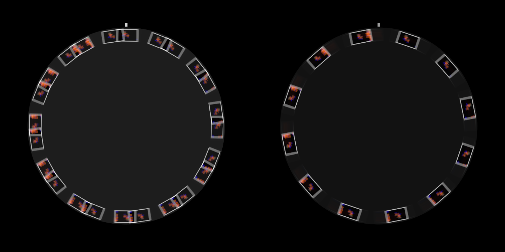

# Zoetrope user guide

Zoetrope is an FFGL effect for [Resolume](https://resolume.com) Arena and Avenue that prints your
clip's frames onto the cards of a spinning disc and only lets you see the disc in the light of a
strobe that fires on the music.

Nothing in it is animated. A print head prints the clip onto each card as the card goes past, the
disc turns, and the camera sees whatever the flashes and a little room light happen to show it.
It's the oldest trick in moving pictures, run backwards: a zoetrope turns a strip of drawings into
motion, and this turns the motion back into a strip and then shows you the strip the way a zoetrope
would. Turn the disc one card per flash and every figure stands still and plays the clip, each a
flash behind the one before it round the ring. Turn it a touch slower and the figures crawl
backwards, like the stagecoach wheels in every western.

The Victorians managed without a strobe. William Horner's drum of 1834, sold in the 1860s as the
zoetrope, used slits in its wall as the shutter, and that's in here too, as the Drum view.


*Resolume's bundled IntoTheGlow_02 through the plugin, rendered by the offline harness rather
than captured from Resolume: a flash on every eighth of a beat at 120 BPM with the disc locked to
it, 20% room light and a 3 ms flash. The cards stand still in the flash, smeared a little by its
length, with the room light's blur of the disc's turn over the same exposure behind them. Going
clockwise from the print head, each card is a sixteenth of a second older than the last.*

> **Before you rely on this:** it's at **v0.1.0**, the first release, and very early days. It has
> **never been loaded into Resolume**, on macOS or on Windows, and the Windows build has never
> been compiled. What's here was compiled, rendered and measured offline on an Apple Silicon Mac
> (macOS 26), by a harness that drives the plugin's own class in a headless GL context, at two
> rasters (1280×720 and 320×180) and again on Apple's software renderer. A disc locked to the beat
> stands still to a ten-thousandth of a pixel over a hundred flashes. A crawl advances by the
> wrapped turn per flash to 3e-8 rad. A smear is ω τ R long to a few hundredths of a percent, and
> a flash keeps its light whatever its length. All 88 cards read over 11 flashes show the frame of
> the clip they were printed with. A hand-spun disc follows an independent RK4 solution of its
> bearing to a ten-millionth of a radian and stops when the closed form says, and flashes land on
> the beat and its subdivisions to 2e-15 s. In the drum the figures stand within 0.02 px of where
> the ray geometry puts them, squeezed to two thirds of their width. Seventeen negative controls
> (models that are wrong on purpose) and thirteen one-character changes to the shipped code are all
> caught, and all 22 controls the sweep can move measurably change the picture (the 23rd, Audio,
> is the input Threshold is swept through). The only host it's run in is the fleet's own test host,
> `oxbow`, which loads it as `SW Zoetrope` (`ZT01`, an effect) and renders 120 frames through it.
> How the 23 controls read in Arena's inspector, how Trigger follows Arena's transport and what
> Resolume's FFT does to the onset detector are all unseen: nobody has measured what Resolume's
> spectrum carries, so Threshold's scale is a guess that worked on the harness's music. Try it on a
> spare layer before you put it in a show.
>
> This codebase was created with AI assistance, directed and reviewed by a human author.

---

## Installing

Every download carries one effect, **SW Zoetrope**. Drop it into Resolume's effects folder and
restart Resolume:

```
macOS    ~/Documents/Resolume Arena/Extra Effects/
Windows  %USERPROFILE%\Documents\Resolume Arena\Extra Effects\
```

Avenue uses the same layout under its own folder name. The effect then shows up in the effects
browser as **SW Zoetrope**.

The macOS download is a universal build (Apple silicon and Intel), as a `.dmg` or a `.zip`. It's
**Developer ID-signed and notarised**, so the bundle just loads. The Windows build had never been
compiled when this was written (see the box above). If there's a Windows download beside the macOS
one, it's an x64 installer or a `.zip`, it isn't code-signed, and the installer trips SmartScreen
once: **More info** → **Run anyway**.

---

## A disc, a strobe and a camera

The plugin is the whole apparatus:

- **The print head** is a grey block just off the rim, at twelve o'clock unless you move it. As
  each card's centre passes it, the card is printed with the frame of the clip that's playing,
  and the print stays until the card comes round again.
- **The disc** carries the cards round its rim, twelve to start with, facing outwards. It turns
  clockwise at whatever speed its drive gives it: a motor locked to Resolume's tempo, a motor at so
  many RPM, or a hand that pushes it on the beat and a bearing that slows it down between pushes.
- **The strobe** fires on the beat or a subdivision of it, on the bar, on onsets in the audio, at a
  free-running rate, or when you press Fire. Each flash is a short rectangle of light with the
  same energy however long it is.
- **The camera** sees whatever lands inside its exposure each frame: the flashes, and a little
  steady room light, added up over the shutter.

None of what follows is drawn. Each is the disc and the light doing what they do:

| what you see | what causes it | group |
| --- | --- | --- |
| figures that stand still and play the clip | the disc turns one card per flash, so every flash finds a card at every station | Disc |
| each figure a flash behind its neighbour round the ring | a print is older the further it has turned from the head | Disc |
| figures crawling backwards or forwards | the disc turns a little less or a little more than a card per flash, and you only see where it ends up | Disc |
| figures jumping about | flashes on onsets land at uneven moments, so the disc has turned however far it happened to | Strobe |
| cards smeared into arcs | a long flash catches the disc moving: the smear is the disc's speed times the flash's length | Strobe |
| a dim spinning blur between flashes | the room light shows the disc as it is, turning through the whole exposure | Camera |
| frames that catch two flashes, or none | a strobe faster than the frame rate beats against the shutter | Camera |
| white cards filling in | a fresh disc is bare card stock until each card passes the head | Disc |

**Cards face outwards.** A card's up is along its radius, so the figure at six o'clock is upside
down. A rigid disc can't keep them all upright; that would be a carousel, which is another plugin.


*Left: Resolume's Trinity_09 through the plugin on its defaults at 120 BPM, two and a half seconds
after it loaded, on the frame that caught the fifth beat's flash. Five cards have passed the print
head and been printed, the newest at the head and each one clockwise from it a beat older; the other
seven are still bare card. Right: NoHopeJustFear_44 with Sync off, RPM 60, a 20 ms Flash and Room
Light 0.03, on the frame that caught the same beat's flash. Each card is smeared along the ring by
the disc's turn during the flash, and as the flash is longer than a frame, this frame caught its
first 17 ms and the next one the rest. Both rendered by the offline harness and cropped to the
disc.*

---

## Start here

Put SW Zoetrope on a layer with a clip in it and leave every control where it is. The defaults are
twelve cards locked to the beat: a millisecond's flash on every beat of Resolume's tempo, the disc
turning one card per flash (10 RPM at 120 BPM), a 360° shutter, so no flash falls between two
exposures, and 8% room light.

The disc starts as a ring of bare white cards and fills in a card a beat, clockwise from the print
head at twelve o'clock. Between beats it turns slowly in the dim room light, and on each beat it
lights up with every card back where the last one was. Each figure plays the clip a beat later than
the one before it round the ring, which at 120 BPM is half a second a card and six seconds all the
way round.

Then, in this order:

1. **Trigger** to **Eighth Beat**. Sync speeds the disc up to keep one card per flash (80 RPM at
   120 BPM), each figure now plays the clip at 16 frames a second, and the ring holds three quarters
   of a second of it. The camera sees a lit frame roughly one frame in four, and the room light in
   between.
2. **Flash** to the top (20 ms). Each card smears along the ring by how far it turns during the
   flash, about a third of a station at 80 RPM. The light per flash doesn't change, so the smear is
   dimmer, not brighter. Bring it back down to the default (0.606 on the slider) or below.
3. **Persistence** to about 0.6 (120 ms). Your eye would smooth those flashes over, and now the
   picture does. It averages the light, so it's dimmer: **Strobe** up towards the top to bring it
   back.
4. **Slip** a hair below the middle (0.49 on the slider, which is Slip 0.98). The figures crawl
   backwards round the ring, about a card every three seconds, still playing. A hair above the
   middle (0.51) and they crawl forwards.
5. **Room Light** up, with Persistence back at 0, to see the disc as it is between flashes: a blur
   as long as its turn over the exposure.
6. **View** to **Drum**, with Trigger on Eighth Beat and Persistence at about 0.6: the same cards
   inside a Victorian drum, seen through slits.
7. **View** back to **Disc**, **Drive** to **Hand**, **Trigger** to **Onset**, and point **Audio**
   at the music. Every hit fires a flash and gives the disc a shove.

**The strobe is the frame rate.** Each figure gets a new card once a flash, so the flashes per
second are its frame rate, and the ring holds Stations flashes' worth of the clip. With Sync on,
the disc's speed follows: RPM = Slip × BPM ÷ (Stations × the beats between flashes). At 120 BPM, with
twelve cards and Slip 1:

| Trigger | flashes a second | the disc | the ring holds |
| --- | --- | --- | --- |
| Bar | 0.5 | 2.5 RPM | 24 s |
| Beat | 2 | 10 RPM | 6 s |
| Half Beat | 4 | 20 RPM | 3 s |
| Quarter Beat | 8 | 40 RPM | 1.5 s |
| Eighth Beat | 16 | 80 RPM | 0.75 s |

More Stations hold more of the past, in smaller cards.

**A word about flashing.** With Persistence at 0 the output does flash, once for every
flash the camera catches. Broadcast guidance on photosensitive epilepsy (Ofcom's, for one) draws
its line at three flashes a second, which Half Beat at 120 BPM is already past. Check before it goes
to a broadcast feed or a big screen in front of an audience.

---

## Recipes

**Locked to the beat.** The defaults, with a faster Trigger if you want the figures to play
smoothly rather than step: Quarter Beat or Eighth Beat. Sync works the disc's speed out from
Resolume's tempo every frame, so it stays one card per flash whatever the tempo does. Slip at the
top of its slider (Slip 2) looks locked too, just skipping a card each flash, and the ring then
holds half as much time.

**Crawling forwards and backwards.** Slip a little either side of the middle of its slider, with
Sync on. Each flash the figures move by however far Slip is from the nearest whole number of cards:
0.98 crawls backwards by a fiftieth of a card a flash, which on Eighth Beat at 120 BPM is a card
every three seconds or so, and 1.02 crawls forwards as fast. Map Slip to a fader over a narrow range
round the middle and you can drive the ring back and forth by hand while it plays. Further out it
speeds up, until around Slip 0.5 and 1.5 half a card per flash looks the same either way and the
ring stops looking like it's going anywhere in particular. Slip 0 stops the disc, and as nothing
then passes the print head, nothing is printed: the ring freezes on its last twelve prints, which
makes a decent freeze button.

**Hand-spun on the kicks.** **Drive** on **Hand**, **Trigger** on **Onset** and **Audio** pointed
at the music. Each onset fires a flash and pushes the disc on by Push, and between hits the bearing
slows it down, so the figures jump by however far the disc turned since the last hit, and the disc
picks up speed through the busy parts and loses it in the gaps. Friction down and it spins on
through a breakdown; up and it stops dead between hits. At the defaults one push takes the disc to
30 RPM and it coasts to a stop in about six and a half seconds. With Trigger on Beat instead, it
winds up over ten seconds or so at 120 BPM to between about 130 and 165 RPM, where a push a beat
balances what the bearing takes. Roughly, it settles at Push ÷ (Friction × the seconds between
pushes). To spin it yourself, Trigger on **Fire Only** and Fire on a pad or a key: each press is a
flash and a shove.

**The Drum view.** **View** on **Drum**, **Trigger** on **Eighth Beat**, so Sync turns it at 80 RPM
at 120 BPM, and **Persistence** at about 0.6 (120 ms). Radius above about 0.77 on its slider makes
the drum wider than the frame, so its sides go and the frame fills with figures. See *The drum*
below for what's different in there.

**Persistence for a room-like look.** Standing in front of a strobe-lit zoetrope, your eye blends
the flashes together; a camera at 60 fps sees one lit frame and a few dark ones. Persistence is the
eye. Between 0.5 and 1 on its slider (100 to 200 ms) with a fast Trigger, the flicker goes, the
figures play smoothly and a crawl looks like a crawl rather than a slideshow. It averages the light,
so bring Strobe up to between 1.5 and 2 (0.75 to 1 on the slider). It also smooths over the camera
aliasing below, if you'd rather not have it.

**The strobe against the camera.** **Trigger** on **Rate** and Persistence at 0. Two ways in:

- *Rate near the frame rate, through a short shutter.* Rate at 61.7 Hz (about 0.824 on its slider)
  and **Shutter** at 90° (0.25). At 60 fps the flashes drift through the camera's exposure, so the
  picture comes and goes 1.7 times a second, the difference between the two rates.
- *Rate well above it.* 157 Hz (about 0.964) through a 200° shutter (0.556). Some frames catch one
  flash and some catch two, so the picture flickers in brightness, and with Slip off the middle a
  frame that catches two flashes shows every card twice.

Anyone who's pointed a camera at an LED wall will recognise it. It's worked out from the host's own
frame times, so in Resolume it'll be as steady as Resolume's frame rate is, which I haven't seen yet.



*Resolume's Galactucity_21 with Trigger on Rate at 157 Hz, Slip 0.3 (so the disc turns 0.3 of a
station between flashes), a 200° Shutter and Card Size 0.5, at 60 fps. Left: a frame whose exposure
caught two whole flashes, so every card is in it twice, 0.3 of a station apart. Right: the next
frame, which caught one. Rendered by the offline harness and cropped to the disc.*

**The disc over the clip.** **Background** on **Clip** puts the clip behind the disc at its own
brightness, rather than in the strobe's light, so the disc floats over the clip it's printing.
Outside the disc the clip's alpha comes through. Radius and Card Size make room round it.

---

## The Strobe group

Every slider in the inspector runs from 0 to 1, except Stations (a whole number) and Sync (on or
off). The ranges below are what those positions mean, and for the sliders that aren't linear, where
the middle is.

- **Trigger:** what fires the strobe. *Beat* (the default), *Half Beat*, *Quarter Beat* and *Eighth
  Beat* follow Resolume's tempo: every beat, or every half, quarter or eighth of one. Eighth Beat is
  an eighth of a beat (a demisemiquaver), not an eighth note; that's Half Beat. *Bar* fires on the
  first beat of each four-beat bar. *Onset* fires on each hit found in Audio. *Rate* runs free at
  Rate. *Fire Only* fires only when you press Fire.
- **Rate:** the free-running strobe, 0.25 to 200 Hz (default 12 Hz; the middle of the slider is
  about 7 Hz, and 60 Hz is at about 0.82). Trigger Rate only. Changing it changes how fast the
  strobe runs from then on, and never jumps it.
- **Fire:** a flash now, whatever Trigger is set to, one per press. With Drive on Hand it's a push
  as well. A press carries no moment of its own, so its flash is placed to end on the frame that saw
  it, and never to start before that frame did.
- **Audio:** Resolume's audio input, which the host fills with a 64-bin spectrum once a frame. In
  the other Stoatworks plugins with this input, Resolume draws it as an audio-source picker; I
  haven't seen this one's panel in Resolume yet. Only Onset reads it. As the spectrum arrives once a
  frame, an onset's flash lands on the first frame whose spectrum has the hit in it. With nothing
  routed, Onset never fires.
- **Threshold:** how hard a hit has to be to count as an onset, 0 to 1 (default 0.4). An onset is a
  sudden rise across the spectrum, and Threshold sets how far it has to clear the music's recent
  average: 1.15 times it at 0, 3.5 times at 1. Onsets are at least 80 ms apart. The detector is
  primed on the plugin's first frame, so music that's already playing when it loads isn't taken for
  a hit. Trigger Onset only.
- **Flash:** how long each flash lasts, 10 µs to 20 ms (default 1 ms; the middle of the slider is
  0.45 ms, and 3 ms is three-quarters of the way up). A xenon tube's flash is tens of microseconds;
  20 ms is a lamp switched on and off. Every flash carries the same light whatever its length, so a
  longer flash smears the cards further without making them brighter. A flash longer than a frame
  runs on into the next one, and the two frames between them get all of it.
- **Strobe:** how much light one flash gives, 0 to 2 (default 1, the middle of the slider). At 1, a
  flash caught whole shows a card at its print's own brightness. In the Drum view it's the lamp's
  level.

---

## The Disc group

Motor turns the disc at a steady speed, Sync's or RPM's. Hand turns it in shoves.

- **Stations:** how many cards, 4 to 48 (default 12). A change of Stations is a new disc: every card
  goes back to bare stock and fills in again as it passes the head, and a hand-spun disc stops.
- **Drive:**
  - *Motor* (the default): a steady speed. With Sync on, Slip cards per flash at Resolume's tempo;
    with Sync off, RPM.
  - *Hand*: a push of Push on every flash of a beat-type Trigger (Beat to Bar), on every onset and
    on every press of Fire, and on Resolume's beat with Trigger on Rate (a 200 Hz strobe pushing the
    disc 200 times a second would only be a motor). Between pushes the bearing slows it. Sync, Slip
    and RPM do nothing on Hand.
- **Sync:** on (the default) or off. On, the motor turns Slip cards per flash. The time between
  flashes is Trigger's share of Resolume's beat, one over Rate on Rate, and one beat on Onset and
  Fire Only, which have no rhythm of their own. A host that sends no tempo counts as 120 BPM.
- **Slip:** cards per flash with Sync on, 0 to 2 in a straight line (default 1, the middle of the
  slider). 1 is locked. Each flash the figures move by Slip's distance from the nearest whole
  number, so 0.98 crawls backwards, 1.02 forwards, and 2 looks locked again, skipping a card. 0
  stops the disc.
- **RPM:** the motor's speed with Sync off, 0 to 600 RPM in a straight line (default 30, which is
  0.05 on the slider).
- **Push:** how much one push adds to the disc's speed, 1 to 120 RPM (default 30; the middle of the
  slider is about 11). Hand only.
- **Friction:** the bearing, 0.05 to 4 per second (default 0.4; the middle of the slider is about
  0.45). One over Friction is roughly how long the disc takes to lose two thirds of its speed: 2.5 s
  at the default. There's dry friction in with it, which takes over below about 2.4 RPM, so the disc
  comes to a stop rather than slowing for ever. One 30 RPM push coasts to a stop in about 6.5 s at
  the default, 52 s at the bottom of the slider and two thirds of a second at the top. Hand only.
- **Print At:** where the print head is, 0 to 360° clockwise from twelve o'clock (default 0). The
  ring's delay starts there: the newest print is at the head and, with Slip at 1, each station
  clockwise from it is a flash older.
- **Radius:** the ring of card centres, 0.15 to 1 of half the frame's shorter side, in a straight
  line (default 0.72). The cards grow with it, and at the top of the slider the cards at twelve and
  six o'clock run off a 16:9 frame. In the Drum view it sets how wide the drum looks instead.
- **Card Size:** how wide the cards are, 0.2 to 1 of the widest card that can't touch its neighbours
  (default 0.9). A card is the clip's shape with a white margin of 6% of the print's height all
  round. More Stations make every card smaller. In the Drum view it's the share of a station's arc a
  card fills.

---

## The Camera group

- **Shutter:** how much of each frame the exposure takes, 0 to 360° in a straight line (default
  360°, the top of the slider). The exposure is the end of the frame, so at 180° it's the second
  half. 360° catches every flash; anything less can miss them (see *If it looks wrong*). A shorter
  shutter also dims the room light and shortens its blur, as a real one would. At 0 the camera sees
  nothing.
- **Room Light:** a dim steady light on the disc, 0 to 1 (default 0.08). At 1 with a 360° shutter it
  gives the disc as much light every frame as one whole flash at Strobe 1, which is about where the
  strobe stops mattering.
- **Persistence:** the eye's afterimage, 0 to 200 ms in a straight line (default 0, which is off;
  the middle of the slider is 100 ms). Each frame keeps exp(−T ÷ Persistence) of the last, T being
  the frame's length, in linear light: at 100 ms and 60 fps that's 85%. A flash's light is all
  kept, spread over the frames after it, so a single flash looks dimmer and softer and a fast strobe
  looks steady. At 0 you get the camera as it is.
- **Background:** *Black* (the default) or *Clip*: the clip behind the disc, at its own brightness
  rather than in the strobe's light. On Black the output is opaque; on Clip the clip's alpha comes
  through outside the disc.
- **Mix:** the result over the clip, 0 to 1 (default 1). At 0 the clip goes through untouched.

Persistence is one exponential, the simplest eye there is. Yours is more complicated and less well
documented.

---

## The View group

- **View:** *Disc* (the default), the cards face on under the strobe, or *Drum*.

---

## The drum


*The drum on IntoTheGlow_02, rendered by the offline harness: Trigger on Eighth Beat at 120 BPM with
Sync on, 120 ms of Persistence, and Radius turned up so the drum is wider than the frame. Without
Persistence you get what a 60 fps camera sees of a zoetrope, which is the slits sweeping across the
figures a few at a time. With the eye's afterimage it reads as it does in the
room.*

View Drum is the original zoetrope: the same cards on the inside of a drum, seen through slits in
its near wall, under steady light. The slits are the shutter. As each slit passes your eye you see a
sliver of the card on the far side, and because the near wall and the far wall move in opposite
directions the figures come out narrower than they're printed, by (d + a) / 2d at the middle of the
view for an eye d from the axis of a drum of radius a. Here the eye is three radii out, so the
figures are two thirds of their printed width.

- **The light is steady:** the Strobe level as a lamp, plus the room light. Flash does nothing in
  here, and Trigger only sets Sync's speed and, on Hand, the pushes.
- **There's a slit for every card,** each a sixteenth of a station wide, and the camera is opened up
  by the slits' duty cycle (sixteen times), much as your eye adapts to one.
- **Radius** sets how wide the drum looks: above 0.81 (0.77 on the slider) it's wider than the frame.
  **Card Size** is how much of a station each card fills. Shutter still sets the exposure.
- **The print head** is behind the drum and isn't drawn. It still prints.
- **It wants a fast disc.** On Beat at 120 BPM it turns at 10 RPM and a slit passes any one spot
  twice a second, so you see a sliver now and then. Put Trigger on Eighth Beat (or Slip up) and
  Persistence at 100 to 150 ms.

---

## Time comes from the host

The disc turns so many radians a second and the strobe fires on Resolume's beat, so the plugin
takes its time from the host's clock. When the host's clock stops, the disc stops turning and the
strobe stops firing. A stall or a jump forward moves things on by a quarter of a second at most, and
a step backwards passes no time. For the first few frames after it loads, while it works out whether
the host counts in seconds or milliseconds, the plugin runs on a steady clock of its own.

**The beat** comes from Resolume's bar phase, which goes once round per bar of four beats. When a
beat, or a subdivision of one, falls between two frames, its flash starts at the moment inside the
frame where it fell rather than at the frame's start, so it lands where the music put it. Onsets and
presses of Fire carry no such moment, so their flash ends on the frame that saw them. A host that
sends no beat gets a clock of the plugin's own, at the host's tempo if it gives one and 120 BPM if
not, so the beat triggers are never dead.

**The exposure** is the end of each host frame: all of it with a 360° shutter, the second half at
180°. What lands in it is worked out from the host's frame times, so it's as even as the host's
frames are.

**Prints** are made a host frame at a time. A card that crosses the print head during a frame gets
that frame of the clip, so a print can be up to a frame later than the moment it stands for.
Changing the composition's resolution keeps the prints, and starts Persistence again from what's on
screen.

---

## How it works

Every frame:

1. **The light**, on the CPU. Whatever's due fires: beats where they fell, Rate's flashes on its own
   clock, onsets and presses at the end of the frame. The camera's exposure becomes a list of light
   segments: the room light over the whole window, and each flash's overlap with it, weighted so
   that a flash caught whole is Strobe's worth of light whatever its length. All of it is solved in
   closed form; nothing about where a flash falls is sampled.
2. **The disc**, on the CPU. The motor's steady speed, or the hand's pushes and the bearing's closed
   form, dω/dt = −kω − c, solved rather than stepped. The cards that crossed the print head during
   the frame are found, and the moment each one crossed is solved from the same closed form.
3. **The prints.** Each card that crossed is printed with this frame of the clip, in linear light,
   into its own layer of a texture array.
4. **The picture**, on the GPU. Each pixel's angle round the disc, then for each light segment a
   set of moments across it, one for every pixel the disc turns past at that radius, up to 64, each
   the card under the pixel at the disc's angle then. Their average, times the segment's light,
   summed over the segments. Past 64 pixels of turn the moments are offset per pixel, so a long
   smear goes grainy rather than stepped. The drum instead follows a ray from each pixel to the near
   wall and the far wall, and works out which slits pass in front of it during the exposure.
5. **The eye**, if Persistence is on: this picture mixed with the last, in linear light.

Light adds, so every average here (a print, a smear, the blur, the afterimage) is taken in linear
light. With Mix at 0 the clip comes through untouched.

---

## Performance

Measured by the offline harness on a Mac (Apple silicon), GPU time per frame, median of 120 frames
after a warm-up, on a GPU shared with other work, so the small numbers wobble from run to run:

| | 720p | 1080p | 4K |
| --- | --- | --- | --- |
| the defaults | 0.08 ms | 0.12 ms | 0.60 ms |
| the worst case I could think of: a 150 Hz strobe of 20 ms flashes on a disc at 600 RPM in room light, with Persistence | 1.9 ms | 3.6 ms | 8.9 ms |
| the drum at 600 RPM, with Persistence | 1.2 ms | 1.2 ms | 3.8 ms |

The worst case at 4K is over half a 60 fps frame. Wall time at the defaults was 0.28, 0.33 and
1.05 ms. Nothing was timed inside Resolume, and nothing was timed on Windows.

---

## If it looks wrong

**The disc never lights up, it's just a dim ring turning.** Shutter is below 360° and the flashes
are falling between exposures. At 120 BPM and 60 fps every beat lands on a frame boundary, and a
180° shutter misses every one of them. Real cameras do this to you too, which is why Shutter is
there and why it isn't the default. Otherwise: Strobe is at 0, Trigger is on Onset with no audio
arriving, or Trigger is on Fire Only.

**All the cards are white.** That's a fresh disc, card stock nobody has printed on yet. Each card is
printed as it passes the head, so it fills in as it turns. A change of Stations starts a new disc.

**The ring has frozen.** Nothing is passing the print head, so nothing is printed: Slip at 0, RPM at
0 with Sync off, or Drive on Hand with nothing pushing it.

**It flickers.** That's the camera: a lit frame for each flash it catches, and the room light in
between. Persistence smooths it over.

**The figures drift when they should stand still.** Slip isn't quite at the middle of its slider,
or Sync is off, or Drive is on Hand. On Onset they jump on purpose: the disc turns steadily and the
hits don't.

**Half the figures are upside down.** They face outwards round the rim, so the one at six o'clock is
on its head.

**Every card is there twice, or the picture pulses.** The strobe is near or above the frame rate
and beating against the shutter (see *The strobe against the camera*). Persistence smooths it over.

**Slip or RPM does nothing.** Slip needs Sync on and RPM needs it off, and neither does anything with
Drive on Hand.

**Push or Friction does nothing.** Drive is on Motor.

**Rate or Threshold does nothing.** Rate only matters with Trigger on Rate, and Threshold only on
Onset, with audio arriving at the Audio input.

**Flash does nothing.** In the Drum view the light is steady. On the disc, a slow disc hardly moves
in a short flash: at the defaults a 1 ms flash smears a card by a fraction of a pixel. Speed the disc
up and it shows.

**No print head in the drum.** It's behind the drum, where it still prints.

**The effect does nothing at all.** That's what a shader that won't compile looks like. The actual
error is in the log:

```
macOS    ~/Library/Logs/zoetrope/zoetrope.YYYY-MM-DD.log
Windows  %LOCALAPPDATA%\zoetrope\logs\zoetrope.YYYY-MM-DD.log
```

It records the build, the GL vendor, renderer and version at load, which shader failed if one did,
whether the cards or the afterimage couldn't be allocated, and what unit the host's clock arrives
in.

---

## Known limits

- **Never loaded into Resolume**, on macOS or on Windows, and the Windows build has never been
  compiled. How the 23 controls in four groups read in the inspector is unseen, and no host has
  played it any music.
- **The inspector shows slider positions**, not hertz, milliseconds or RPM. This guide gives the
  ranges, and where the middle of each slider is.
- **Resolume's spectrum is unmeasured.** Nobody has measured what Resolume's bins carry, so
  Threshold's scale is a guess that worked on the harness's music.
- **Prints are made a frame at a time.** A card is printed with the frame the host hands over on the
  frame its centre passes the head, up to a frame later than the moment it stands for.
- **At most eight flashes** are caught in one exposure, and any more are dropped. 200 Hz at 30 fps
  through a 360° shutter is seven.
- **The look is a model, and a dim one.** The disc's motion, the flashes and the exposure are worked
  out properly; what a real disc looks like (its card stock, its shadows, the print head) isn't.
- **The drum's geometry is fixed:** the eye three radii from the axis, so the squeeze is always two
  thirds, and the slits a sixteenth of a station. Its camera gain is a choice of exposure, not
  physics. On Hand, when each slit opens is worked out from a 16-piece table across the exposure,
  which is close (about 1e-5 rad) but not the closed form.
- **Cards face outwards.** There's no carousel mode to keep the figures upright.
- **Every flash is the same.** A soft hit and a hard one give the same light; there's no Accent.
- **No presets**, no browser demo and no OpenFX version.

---

## About

The last group, **About**, has the plugin's name, version, licence and maker, and buttons that open
the project page, the source on GitHub and the support page in your browser.

## Links

- Project page: [stoatworks-labs.com/software/zoetrope](https://stoatworks-labs.com/software/zoetrope/)
- Source: [github.com/stoatworks-labs/zoetrope](https://github.com/stoatworks-labs/zoetrope)

## Reporting something

If something's wrong, shout at
[github.com/stoatworks-labs/zoetrope/issues](https://github.com/stoatworks-labs/zoetrope/issues).
A screenshot, the Trigger, Drive and View, any controls you moved, whether audio was routed, and the
composition's resolution and frame rate are usually enough.
